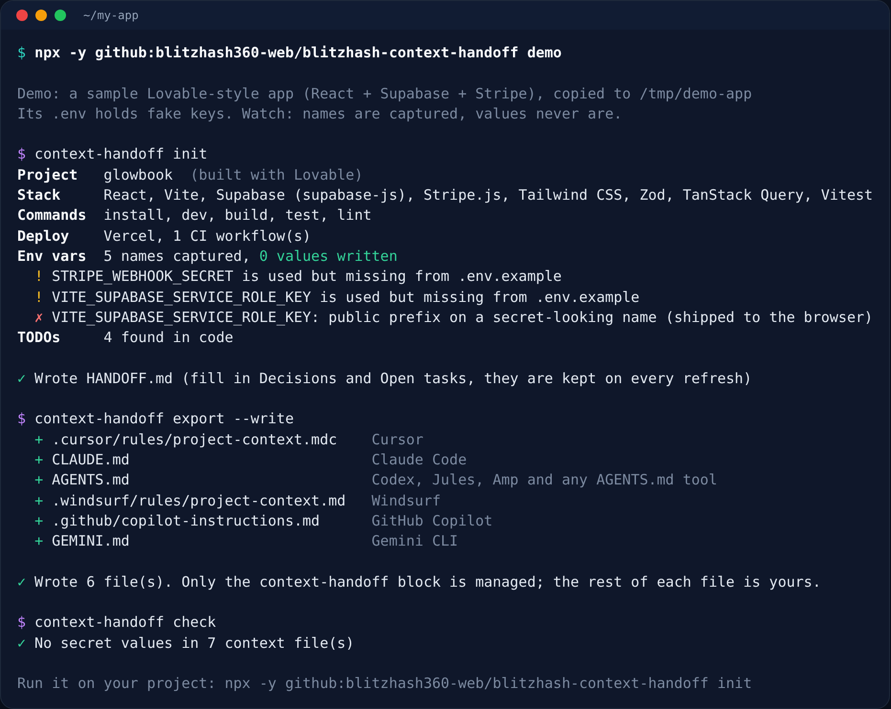

# BlitzHash Context Handoff

**Switch AI tools or hand your app to a developer without losing the plot: one `HANDOFF.md` with your stack, commands, env var names, TODOs and decisions, converted to Cursor, Claude Code, AGENTS.md, Windsurf, Copilot and Gemini rules. Secret values never leave your `.env`.**

[](LICENSE)
[](https://github.com/blitzhash360-web/blitzhash-context-handoff/actions/workflows/ci.yml)


[](https://github.com/blitzhash360-web/blitzhash-context-handoff/stargazers)


<sub>`npx -y github:blitzhash360-web/blitzhash-context-handoff demo` on a sample Lovable-style app. Its `.env` holds fake keys; only the names reach the output.</sub>

## Quick start (3 steps)

```bash
# 1. Try it on a sample app (runs in a temp folder, touches nothing of yours)
npx -y github:blitzhash360-web/blitzhash-context-handoff demo

# 2. In your project folder: write HANDOFF.md
npx -y github:blitzhash360-web/blitzhash-context-handoff init

# 3. Preview, then write the rules file for every AI tool
npx -y github:blitzhash360-web/blitzhash-context-handoff export          # dry run
npx -y github:blitzhash360-web/blitzhash-context-handoff export --write
```

Node 18.17+ and nothing else. No account, no API key, no network calls (the `npx` download aside).

## Why

You built the app in Lovable or Bolt, moved to Cursor, tried Claude Code, and now a freelancer is taking a look. Every switch starts from zero: the new tool (or person) doesn't know which env vars exist, which command runs the tests, that the webhook still isn't verified, or why you picked Supabase. You end up re-explaining, and the AI guesses.

`context-handoff` writes that down once, from the code, and keeps every tool's rules file in sync with it.

## What goes into HANDOFF.md

| Section | Where it comes from |
|---|---|
| What this is, built with | `package.json` name and description; Lovable, Bolt, Replit and Cursor markers |
| Stack | Dependencies: Next.js, React, Vite, Supabase, Firebase, Prisma, Drizzle, Stripe, Clerk, Auth.js, Tailwind, OpenAI, Anthropic, Vercel AI SDK, Zod, Sentry and more (plus FastAPI, Django, Flask) |
| Commands | Your lockfile's package manager and `dev`, `build`, `test`, `lint`, `typecheck`, migrate scripts |
| Where things live | Pages, components, lib, API routes, Supabase Edge Functions, SQL migrations, Prisma/Drizzle schema |
| Environment variables | **Names only**, from `.env*` files and code (`process.env`, `import.meta.env`, `Deno.env.get`, `os.environ`), with which ones are missing from `.env.example` |
| Warnings | Secret-looking names with a public prefix (`NEXT_PUBLIC_`, `VITE_`, `EXPO_PUBLIC_`...), which means the value ships to every visitor's browser |
| Deploy and CI | Vercel, Netlify, Cloudflare Workers, Docker, Railway, Render, Fly.io, Firebase, GitHub Actions |
| TODOs found in code | `TODO`, `FIXME`, `HACK` comments with file and line |
| Recent changes | Last 8 commit subjects |
| **Decisions, Conventions, Open tasks, Gotchas** | **You.** These sections are seeded once and never overwritten on refresh |

Re-run `init` any time. Only the block between the `context-handoff:auto` markers is regenerated.

## Export targets

| Target | File | Read by |
|---|---|---|
| `cursor` | `.cursor/rules/project-context.mdc` | Cursor (`alwaysApply: true`) |
| `claude` | `CLAUDE.md` | Claude Code |
| `agents` | `AGENTS.md` | Codex, Jules, Amp and other AGENTS.md tools |
| `windsurf` | `.windsurf/rules/project-context.md` | Windsurf |
| `copilot` | `.github/copilot-instructions.md` | GitHub Copilot |
| `gemini` | `GEMINI.md` | Gemini CLI |

`export` is a dry run until you add `--write`. In a file you already have (say your own `CLAUDE.md`), only the `<!-- context-handoff:start -->` block is added or replaced; the rest stays yours. A hand-written `.cursor/rules/project-context.mdc` is skipped unless you pass `--force`. Limit targets with `--to cursor,claude`.

Each export also adds four short working rules for the agent: read the context first, never ask for or print secret values, make the smallest change, and update Open tasks when done.

## Secret safety

- `.env` files are parsed for **variable names only**. Values are dropped as each line is read and never stored, printed or written.
- Everything written (TODO text and commit subjects included) passes through a redaction step for JWTs and Supabase keys, Stripe keys and webhook secrets, GitHub, AWS, OpenAI/Anthropic, Slack and Google keys, private key blocks and URLs with passwords.
- `init` and `export` refuse to write if their output still matches a secret pattern.
- `check` is a CI gate: it fails if `HANDOFF.md` or any exported file contains something that looks like a key, and warns if `HANDOFF.md` is out of date. Copy [`examples/github-action/context-check.yml`](examples/github-action/context-check.yml) into `.github/workflows/`.
- Tests ([`test/handoff.test.mjs`](test/handoff.test.mjs)) run the full flow on a fixture with fake `.env` values and assert none of them appear in any output file.

## Use it from your AI agent

Copy [`skills/context-handoff/`](skills/context-handoff/SKILL.md) into `~/.claude/skills/` (Claude Code) or `.agents/skills/` (other Agent Skills tools), then ask: *"Write a handoff for this project."* The skill runs the scan, asks you the three questions code can't answer (decisions, open tasks, gotchas), shows the export plan and writes only after you say yes.

## Commands

```text
context-handoff demo                 sample app in a temp folder
context-handoff scan [dir]           print what init would write (writes nothing; --json for raw data)
context-handoff init [dir]           create or refresh HANDOFF.md
context-handoff export [dir]         dry run; --write, --to <list>, --force
context-handoff check [dir]          CI gate for secrets and staleness
```

`--no-git` skips commit history. Colors follow `NO_COLOR` / `FORCE_COLOR`.

## Going to production? What this doesn't cover

A good handoff tells the next person what exists. It doesn't tell them whether it's safe or will hold up. Before real users and real money arrive, a senior engineer would also:

- Check every table's Row Level Security or access rules against how the app actually queries data
- Rotate any key that was ever in a public variable, a chat log or git history
- Verify payment webhooks, add rate limits to auth and API routes, and set security headers
- Load-test the paths that matter (sign-up, checkout, search) and fix the slow queries
- Set up backups you have restored at least once, error monitoring and alerts
- Right-size hosting and database plans so the bill grows with revenue, not ahead of it

**Want a second pair of eyes?** BlitzHash does these reviews for AI-built apps. [Get a free assessment](https://blitzhash.com).

## Related BlitzHash tools

- [blitzhash-vibe-coding-rules](https://github.com/blitzhash360-web/blitzhash-vibe-coding-rules): security and scaling rules for your AI coding agent
- [blitzhash-launch-ready-check](https://github.com/blitzhash360-web/blitzhash-launch-ready-check): score a live URL out of 100 before launch
- [supabase-rls-check](https://github.com/blitzhash360-web/supabase-rls-check): find open Supabase tables in your migrations

## Credits

Original BlitzHash work, MIT licensed, no third-party code. Output formats follow the public docs for [Cursor rules](https://docs.cursor.com/context/rules), [Claude Code memory](https://docs.anthropic.com/en/docs/claude-code/memory), [AGENTS.md](https://agents.md), [Windsurf rules](https://docs.windsurf.com/windsurf/cascade/memories), [GitHub Copilot custom instructions](https://docs.github.com/en/copilot/customizing-copilot/adding-repository-custom-instructions-for-github-copilot), [Gemini CLI context files](https://github.com/google-gemini/gemini-cli) and the [Agent Skills](https://agentskills.io) `SKILL.md` format. Not affiliated with any of these tools.

---

Built by BlitzHash: need a senior team to check or scale your AI-built app? Free assessment at https://blitzhash.com
